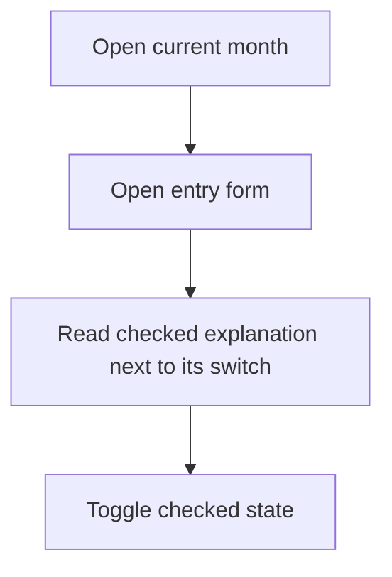
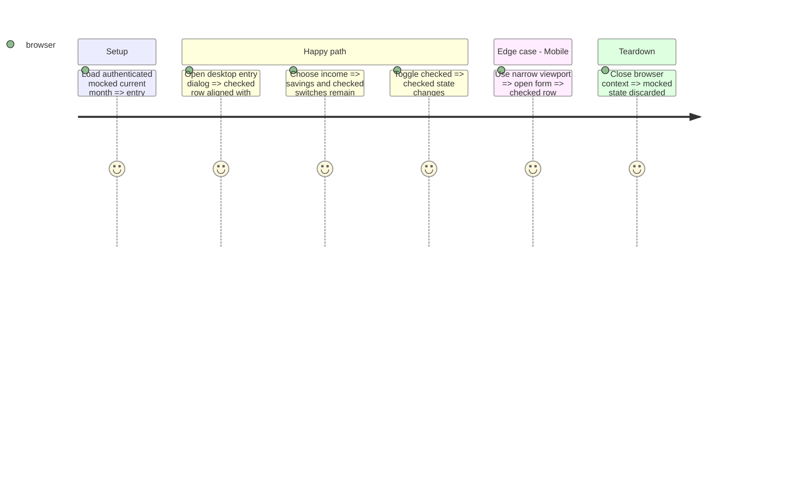

# Instruction: Keep both controls readable at every width

## Architecture projection

```txt
frontend/
  projects/webapp/src/app/feature/current-month/components/add-transaction-form.ts  modify: scoped desktop layout
  e2e/tests/features/current-month-transactions.spec.ts  modify: browser layout regression
```

## User Journey



## Test Scope



## Wireframe

```txt
┌──────────────────────────────────────────┐
│ 1. Entry title and date                  │
├────────────────────┬─────────────────────┤
│ 2. Amount          │ 3. Description       │
│    Quick amounts   │    Nature / tags    │
│                    │    Savings source   │
│                    │ 4. Checked    [ o ] │
├────────────────────┴─────────────────────┤
│ 5. Actions                               │
└──────────────────────────────────────────┘
```

1. Existing heading and date span the form.
2. Amount inputs stay in the left column.
3. Details stay in the right column.
4. Checked label, explanation and switch share the right column from 768px; the entire form uses one vertical column below 768px, including narrow dialogs.
5. Existing dialog actions remain below the form.

## Execution status

Implementation, local verification and independent review are complete; see [validation.md](./validation.md) and [review.md](./review.md). Delivery evidence is tracked in PR #812.

## Completed work

### `1)` Fix the layout and validate

1. Inspect both form shells and existing browser tests; keep handset and scroll-owner selection unchanged.
2. Correct the checked row placement without changing form values, accessibility bindings or persistence.
3. Verify expense/income at 600, 767, 768, 1440 and 390px with browser geometry, both switch interactions, scroll and visible actions.
4. Run relevant checks and strict template build, independent AIDD review and outcome challenge.

## Test acceptance criteria

| Task | Acceptance criteria                                                                                                                     |
| ---- | --------------------------------------------------------------------------------------------------------------------------------------- |
| 1    | At 768px and wider, checked explanation starts in the details column, with its switch alongside it.                                     |
| 1    | Income savings source and checked controls remain distinct and aligned.                                                                 |
| 1    | Below 768px, amounts, details and both switches share one column; content scrolls and actions stay visible without horizontal overflow. |
| 1    | Mobile has no horizontal overflow and checked state remains interactive.                                                                |
| 1    | Existing submission payload and accessible name/description remain unchanged.                                                           |
