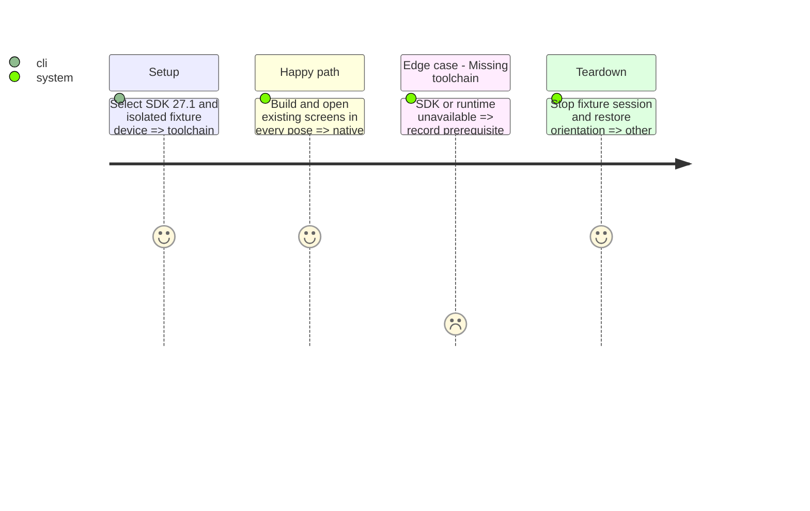

# Instruction: Establish the SDK and native baseline

## Architecture projection

> ✏️ modify · ✅ create; no deletions.
```txt
ios/project.yml                                      ✏️ supported orientations and SDK-compatible settings
ios/Pulpe/Resources/Info.plist                         ✏️ generated orientation parity only
.github/workflows/ci.yml                              ✏️ verified toolchain and simulator selection
.github/workflows/ios-distribute.yml                   ✏️ align archive toolchain, preserve release gates
aidd_docs/tasks/2026_10/2026_10_21_ios-iphone-duo/
└── native-review.md                                  ✅ actual screenshots, versions and visual decisions
```

## Test Scope



## Tasks to do

### `1)` Establish a reproducible native reference
1. Follow `ios/CLAUDE.md`: XcodeGen is authoritative; generate with `--use-cache`. Active local Xcode is 26.6; CI pins 26.6 and distribution 26.2. Local runtimes stop at iOS 26.5; Xcode 27.1 requires a newer macOS. The verified GitHub `xcode-27` image supplies Xcode 27.1; download its 27.1 runtime explicitly.
2. Verify Xcode/SDK 27.1+, runner availability and exact new API availability before updating pins or using APIs; select a task-local toolchain, without changing the global developer directory. If unavailable, record the toolchain/runner prerequisite before claiming native readiness.
3. Enable landscape left/right through `project.yml`, preserve the iOS 18 target and device family 1, regenerate, and build Local plus unsigned Prod. Keep CI/security/distribution gates intact; update the iOS-26-only runtime resolver together with its pin.
4. Push an explicitly incomplete prerequisite checkpoint and create a draft PR to execute the existing PR-only CI on the verified runner. Keep this phase in progress until remote build and native evidence pass; never bypass release gates. Capture the existing home, annual budget, budget detail and entry form on outer, inner portrait, inner landscape, book and tabletop poses. Use an isolated Duo simulator and the dedicated `Pulpe Tests` device for existing suites; never the user's booted device.
5. Compare native rendering against `PRODUCT.md → DESIGN.md → ios/DESIGN.md` and actual components. Record toolbar, avatar, hero, scroll, keyboard and fold defects; preserve the current home hero treatment. Work in reviewable increments; beyond ~300 net LOC, propose 2–3 alternatives before continuing.

## Test acceptance criteria

| Task | Acceptance criteria |
| --- | --- |
| 1–3 | Builds retain existing supported OS behavior; CI and archive use a verified compatible SDK without releasing anything. Missing infrastructure is recorded explicitly. |
| 4–5 | Real SwiftUI captures distinguish system chrome from content and identify remaining defects; no HTML rendering is accepted as native evidence. |
