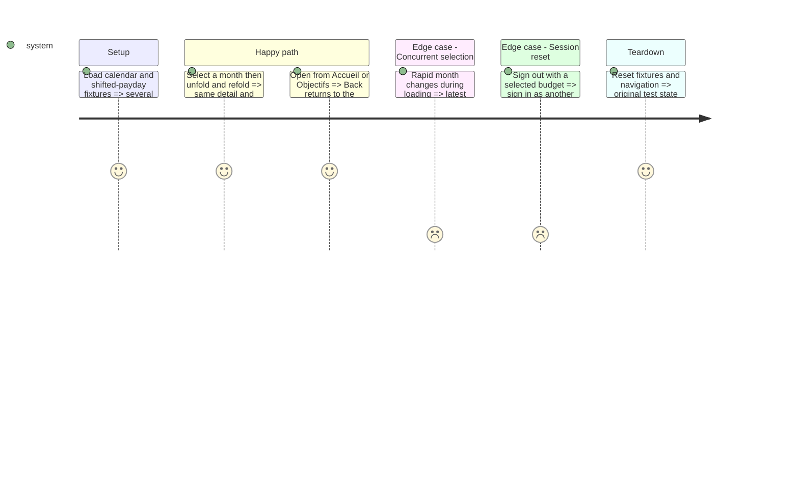

# Instruction: Adapt budget navigation without losing context

## Architecture projection

> Paths below are relative to `ios/`; ✏️ modify · ✅ create; no deletions.
```txt
Pulpe/App/MainTabView.swift                            ✏️ native list/detail container in Budgets
Pulpe/App/AppState.swift                               ✏️ stable selected budget and year
Pulpe/App/AppState+Navigation.swift                    ✏️ one budget entry contract
Pulpe/App/AppState+SessionReset.swift                  ✏️ clear new selection with navigation
Pulpe/App/PulpeApp.swift                               ✏️ route budget deep links through that contract
Pulpe/Features/Budgets/BudgetList/BudgetListView.swift  ✏️ reuse list, creation and annual overview
Pulpe/Features/Budgets/BudgetList/BudgetListRefreshPolicy.swift ✏️ visible-pane refresh semantics
Pulpe/Features/Budgets/BudgetDetails/BudgetDetailsView.swift ✏️ stable detail identity and selection binding
Pulpe/Features/Budgets/BudgetDetails/BudgetDetailsView+MonthMenu.swift ✏️ synchronize month changes
Pulpe/Features/Budgets/BudgetDetails/Routing/BudgetDetailsRouter.swift ✏️ preserve active-stack routing
PulpeTests/Features/Budgets/BudgetDetails/BudgetDetailsRouterTests.swift ✏️ selection and origin regressions
PulpeTests/Features/Budgets/BudgetListRefreshPolicyTests.swift ✏️ invalidation while list stays visible
PulpeTests/App/AppStateResetMatrixTests.swift           ✏️ session isolation
Pulpe/App/ContextualCreationUITestHarness.swift         ✏️ deterministic multi-month fixtures
PulpeUITests/IPhoneDuoContinuityUITests.swift            ✅ navigation and resize scenarios
```

## Test Scope



## Wireframe

Outer display                         Inner portrait
```txt
┌───────────────────┬─────┐  ┌────────────────────────────┐
│ (5) Selected pane│ (4) │  │ (4) Navigation             │
│                   │ Bars│  ├───────────┬────────────────┤
└───────────────────┴─────┘  │ (2) Months│ (3) Detail     │
                             ├───────────┴────────────────┤
                             │ (4) Tabs                   │
                             └────────────────────────────┘
```
Inner landscape / book
```txt
┌────────────────┬────────────────────────┬─────┐
│ (1) Year       │ (3) Month summary      │ (4) │
│ (2) Months     │     Forecasts          │ Bars│
│                │     Movements          │     │
└────────────────┴────────────────────────┴─────┘
```
1. Year context: year selection and access to the existing annual overview.
2. Months: a native selection list containing existing month information.
3. Detail: the selected budget and its existing actions.
4. System bars: detail navigation and application destinations; positions follow the system.
5. Compact content: the month list or the selected budget.

## Tasks to do

Implementation is split into two reviewable increments: shared selection/navigation guards
and their regressions first, then the native container and continuity capture. The state
increment may start after the local build prerequisites while remote baseline captures run;
only the container/presentation increment depends on reviewing those captures. Neither
increment completes this phase on its own. Preserve nested goal-to-budget pushes and
`SessionResetScope.clearsNavigation`; block root month selection while a child editor or
sheet is active so local drafts are not silently discarded.

### `1)` Let the native container manage the extra hierarchy
1. After phase 1, compare a native two-pane capture with the baseline, then use `NavigationSplitView` with a native `List(selection:)` and the existing typed detail stack. Keep one stable hierarchy across widths; no conditional replacement stacks or copied detail view. Compact width presents the selected pane; narrow regular width and accessibility text may collapse.
2. Reuse existing month labels, amounts, masking, payday periods, creation/planning sheets and annual recap access. Selection uses native treatment, without the rejected inset card/green stripe; no fixed mockup width. Current-period and selected-month states remain distinct.
3. Give the selected budget one owner at the tab/app boundary; synchronize list, title menu, pager and coordinator after successful month navigation. Preserve the existing pending-change checks, error handling and latest-request cancellation. Explicitly handle year changes, creation, missing/deleted budgets and rapid selections.
4. Route direct Budgets entries and deep links through the same selection contract. Keep Accueil and Objectifs entries on their existing stacks; inspect their callers in `CurrentMonthView`, `MonthRecapCard` and `SavingsGoalDetailView`. Reset selection on session reset; do not decode opaque `NavigationPath` contents.
5. Adapt refresh policy to pane visibility rather than assuming an empty path; do not reset year in a task rerun caused by resize. Reuse existing stores and mutation invalidation. Retain filters, selected row, meaningful scroll anchor, sheet and draft while width changes.

## Test acceptance criteria

| Task | Acceptance criteria |
| --- | --- |
| 1–2 | Native list/detail expands only when readable; month creation, annual overview and every existing action remain available in compact layout. |
| 3–5 | List and detail agree after menu/pager/create/deep-link navigation; failed loads are retryable; folding neither changes the month nor creates duplicate requests or writes. Originating Back and session-reset tests pass. |
