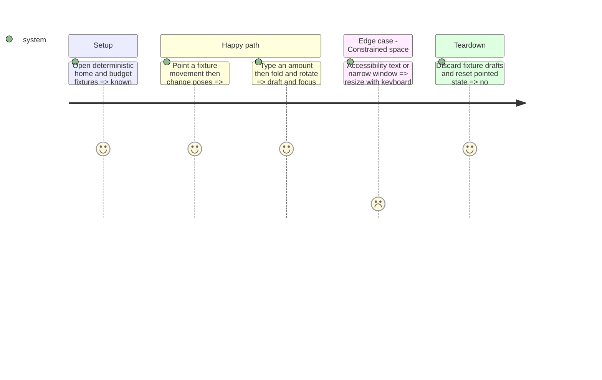

# Instruction: Adapt home, forms and fold-sensitive content

## Recorded outcome

Implemented with adaptive native bars, bounded hero backgrounds, the wider home chart and preserved form state. Current Duo geometry and classic-device rotations pass; broader fold/accessibility combinations remain unqualified. See [validation.md](validation.md) for exact evidence and limits.

## Architecture projection

> Paths below are relative to `ios/`; ✏️ modify where the native baseline demonstrates a defect; no new abstractions or deletions.
```txt
Pulpe/Features/CurrentMonth/CurrentMonthView.swift      ✏️ home layout and semantic account action
Pulpe/Shared/Components/HeroZone/HeroZoneSurface.swift  ✏️ native bar-edge/background handling
Pulpe/Shared/Components/SheetFormContainer.swift        ✏️ shared form sizing and focus continuity
Pulpe/Shared/Extensions/View+Extensions.swift           ✏️ existing sheet and sticky-action modifiers
Pulpe/Features/Budgets/BudgetDetails/BudgetDetailsView.swift ✏️ shared detail toolbar and content layout
Pulpe/Features/Budgets/BudgetDetails/BudgetDetailsStickyPagerLayer.swift ✏️ remove top-edge assumptions
Pulpe/Features/Budgets/BudgetDetails/BudgetDetailsScrollTracker.swift ✏️ pane-relative geometry
Pulpe/Features/Budgets/BudgetList/BudgetListView.swift  ✏️ semantic creation and planning controls
Pulpe/Shared/Design/DesignTokens.swift                  ✏️ only measured missing layout tokens
PulpeUITests/IPhoneDuoContinuityUITests.swift            ✏️ fold, keyboard and draft preservation
PulpeUITests/ContextualCreationUITests.swift             ✏️ retain accessible creation regressions
```

## Test Scope



## Wireframe

Home in tabletop pose                 Entry sheet
```txt
┌────────────────────────────┐  ┌────────────────────────────┐
│ (1) Navigation             │  │ (5) Sheet navigation       │
├────────────────────────────┤  ├────────────────────────────┤
│ (2) Summary and chart      │  │ (6) Choices and amount     │
├────────────────────────────┤  │     Description and details│
│ (3) Pending items/activity │  │     Primary action         │
├────────────────────────────┤  ├────────────────────────────┤
│ (4) Tabs                   │  │ (7) System keyboard        │
└────────────────────────────┘  └────────────────────────────┘
```
1. Navigation: current month and account access.
2. Summary: existing estimate, trajectory and metrics.
3. Working area: existing pointing, activity and creation content.
4. Tabs: the four destinations; this sketch represents inner portrait.
5. Sheet navigation: title and dismissal.
6. Form: the existing field order and submission action.
7. Keyboard: the system input area; placement follows the system.

## Tasks to do

### `1)` Adapt content without inventing pose-specific experiences
1. Use the existing home hero/chart and ledger blocks: “Estimé fin…” stays distinct from budget “Disponible à dépenser”. Prototype a two-region home only where useful; a native `ArrangementView` may split the existing summary and working area if verified SDK support and readability justify it. Keep navigation outside and scrolling inside its regions; never nest it in `NavigationSplitView`, a list or an outer scroll view.
2. Prefer native reserved-region handling; add local geometry handling only for demonstrated custom-content collisions. A fold is a space constraint, not a trigger for new functionality. Keep the existing single-column hierarchy where the content does not benefit from two regions.
3. Give toolbar controls localized titles and symbols, semantic placement and system overflow. Check the custom avatar explicitly; avoid replacing native glass with forced backgrounds. Use the actual toolbar edge for hero/scroll/pager adjustments, and avoid duplicate month navigation when the list is visible.
4. Reuse `SheetFormContainer`, `HeroAmountField`, native keyboard and `.standardSheetPresentation()`; retain current field order, validation, errors, pending-submit protection and focus. Do not move an active sheet into a custom inline editor or invent a tabletop keypad.
5. Apply `ios/DESIGN.md`, token and hit-area rules: current Pulpe surfaces/typography, glass only on navigation, masking and currency precision, Dynamic Type, VoiceOver order, Reduce Motion and Reduce Transparency. Gate SDK-specific APIs with a working older-OS path.

## Test acceptance criteria

| Task | Acceptance criteria |
| --- | --- |
| 1–3 | Summary, money, controls and selected rows stay legible outside active fold/camera regions; rotations preserve hierarchy and system bar placement. |
| 4–5 | Partially entered values, focus, validation and save/cancel survive resizing; save creates one operation; masked amounts and accessibility remain correct in both color schemes. |
