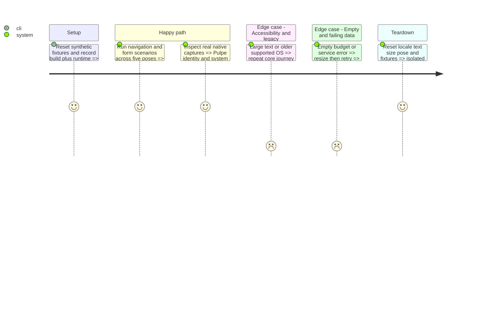

# Instruction: Verify continuity, capture and deliver TestFlight

## Recorded outcome

Internal beta delivered: 1.11.0 (1), source `d93e69614`, available to `Moi` with French test notes. Native evidence, signing/provenance and the TestFlight readback are recorded in [validation.md](validation.md). The full five-pose and accessibility qualification remains partial; delivery does not certify the entire planned matrix.

## Architecture projection

> ✏️ modify · ✅ create; no deletions.
```txt
ios/PulpeUITests/IPhoneDuoContinuityUITests.swift        ✏️ final representative regression matrix
ios/DESIGN.md                                         ✏️ verified iOS-specific adaptive rules only
aidd_docs/tasks/2026_10/2026_10_21_ios-iphone-duo/
├── validation.md                                     ✅ results, limitations and capture manifest
└── captures/                                         ✅ native screenshots from synthetic fixtures
```

## Test Scope



## Tasks to do

### `1)` Close the native evidence loop
1. Run SwiftLint and relevant Swift Testing suites plus XCUITest through the `PulpeUITests` scheme, following `ios/CLAUDE.md`; confirm nonzero executed counts. Cover router/reset/refresh, existing `MainTabViewLayoutTests`, `NavigationKeyboardInsetTests`, contextual creation and pointing. Run iOS CI and unsigned Prod build with the aligned SDK.
2. Verify outer, inner portrait, inner landscape, book and tabletop; also resize in multitasking. Automate supported controls and document manual fold/Device Hub steps rather than simulating a fold with a screenshot size. Cover live resize with a sheet, nested edit, pending request and pointed item.
3. Smoke all four tabs, settings, login/unlock and onboarding; test long translated labels, calendar/shifted payday, empty/error states, hidden amounts, light/dark, accessibility text, VoiceOver, Reduce Motion and Reduce Transparency. Preserve auth privacy and background locking across display changes.
4. Reuse `ContextualCreationUITestHarness`, current capture routes and XCUITest attachments with synthetic data; export genuine images to this task's captures directory. Existing marketing tooling targets iPhone 17 Pro Max/iOS 26.5: do not overwrite those assets or pretend resizing them produces Duo evidence.
5. Record native UI review, build/SDK/runtime, executed counts and each coverage gap. Verify App Store image dimensions against the linked specification, without alpha; prepare outer and inner assets and keep folded-pose review captures distinct. Update only proven iOS-specific design rules. The 2026-10-23 user request supersedes the earlier no-upload boundary: after validation, archive the exact dedicated-branch commit, resolve an unused build number from App Store Connect, sign/export/upload, wait for processing and assign the existing internal testing group with French test notes. Record build ID, version, number, source SHA and group availability; do not submit App Review or bypass existing main/staging proof gates.

## Test acceptance criteria

| Task | Acceptance criteria |
| --- | --- |
| 1–3 | Core journeys preserve data, selection and draft state across supported layouts; iPhone regressions and remaining untested OS/device combinations are explicitly reported. |
| 4–5 | Review uses actual SwiftUI screenshots; assets have correct dimensions and synthetic data. TestFlight readback proves that the exact validated build is processed and available to the existing internal group. No App Review submission; device-only validation gaps remain explicit. |
