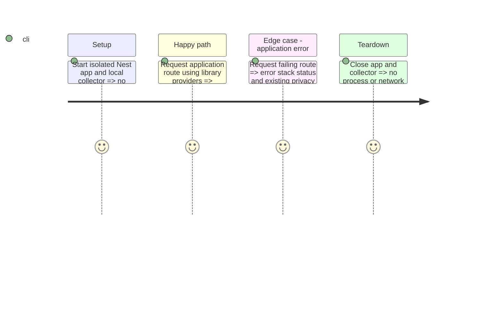

# Instruction: Reduce Observe span volume

## Architecture projection

```txt
backend-nest/src/
  observe.ts                                      modify: skip ConfigService and ClsService instrumentation
  observe.spec.ts                                 modify: verify reduced spans and preserved diagnostics
  test/fixtures/observe-privacy.fixture.ts         modify: exercise real library and application providers
```

## Test Scope



## Tasks to do

### `1)` Exclude library provider instrumentation

1. Read all Observe callers and preserve every existing privacy option.
2. Use SDK `skipInstrumentation` with `instanceof ConfigService` and `instanceof ClsService`; include subclasses.
3. Extend the existing collector test to prove library spans disappear while application spans and errors remain.
4. Run backend quality, build and the isolated telemetry journey; obtain independent review and challenge.

Implementation validation: `bun run --bun --cwd shared build`, backend `bun run --bun quality` (0 errors, 52 existing lint warnings; no architecture violations across 687 modules), and `bun run build` pass. The final isolated `bun test src/observe.spec.ts` passes 38 assertions after quality checks. The same collector test failed on library spans before the production predicate was added. The fixture verifies HTTP 200 and unchanged provider return values, application spans, HTTP 500/error stack, and existing privacy redaction. Macro and micro architecture: no violations; the change remains in the composition root and isolated test fixture. Independent review and challenge approved candidate `702023e89` with zero findings. Full root pre-commit quality passed.

### `2)` Configure span sampling

1. In the Pulpe Observe project's spend controls, set span sampling to 25%.
2. Verify saved state, preserving request/error collection and slow/failed waterfalls.
3. If authentication blocks access, report it explicitly; do not replace it with SDK trace sampling or aggressive span dropping.

Dashboard validation: saved Pulpe span sampling at 25%; readback shows `SPAN SAMPLING 25% kept`, rate cap remains plan default, drop filters remain none.

## Test acceptance criteria

| Task | Acceptance criteria                                                                                                                                                                    |
| ---- | -------------------------------------------------------------------------------------------------------------------------------------------------------------------------------------- |
| 1    | ConfigService and ClsService (including subclasses) produce no method spans; application providers/controllers still produce useful spans and errors without sensitive request values. |
| 2    | Pulpe project spend controls show 25% span sampling, or the exact authentication blocker is recorded.                                                                                  |
