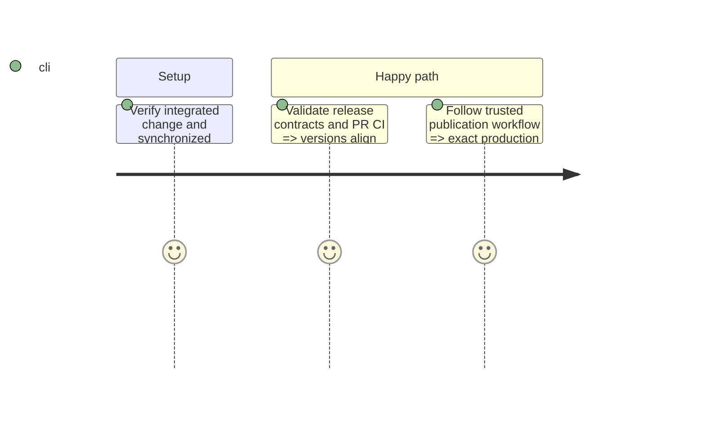

# Instruction: Publish a silent minor release

## Architecture projection

```txt
package.json                                      modify: next product minor
{frontend,landing,backend-nest,shared,android}/
  package.json                                    modify: Changesets fixed version alignment
  CHANGELOG.md                                    modify: mechanical release history
android/app.json                                  modify: Expo product version alignment
.release/manifest.json                            modify: exact French technical release notes
frontend/projects/webapp/src/app/layout/whats-new/
  whats-new-releases.ts                           modify: explicit silent release entry
```

## Test Scope



## Tasks to do

### `1)` Publish through the trusted release chain

1. Integrate reviewed implementation through a PR to main.
2. Follow the release skill preflight, proposal and authorization rules for the next minor, with What's New skipped.
3. Keep iOS version, App Store submission, public landing notes and in-app feeds untouched; record web silence explicitly.
4. Validate release contracts and quality, then create the mechanical release PR with immutable manifest and exact marker.
5. Use the existing automated staging, production and publication chain and verify its outcome.

## Test acceptance criteria

| Task | Acceptance criteria                                                                                                                                                                                                    |
| ---- | ---------------------------------------------------------------------------------------------------------------------------------------------------------------------------------------------------------------------- |
| 1    | All seven product version fields agree on the approved minor; landing and mobile novelty feeds have no new entry; web toast is explicitly silent; trusted CI proves the exact deployed version before tag publication. |
